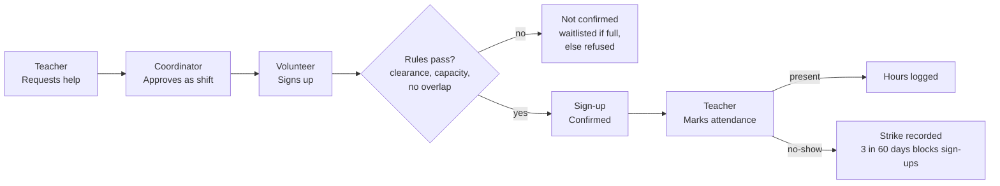

# Volunteer Shift Coordinator — PRD

Last Updated: Nov 10 2026

## Overview

We are building a web app that lets one volunteer coordinator staff six elementary schools from a single place: teachers request help, the coordinator turns requests into shifts, cleared volunteers fill them, and teachers confirm attendance so hours are logged.

**Problem.** The coordinator who works with Anne Darling Elementary manages volunteers across six schools. Requests, sign-ups, clearances and hours are spread across separate channels, so it is hard to know who is cleared for which school, which shifts are unfilled, and who actually showed up.

**Solution.** One shared system with three roles, server-enforced permissions, and back-end rules for clearances, conflicts, waitlists, swaps and hour tallies. Data lives in PostgreSQL on Neon so it survives redeployments to Google Cloud Run.

## Goals

**Goals**

- A teacher can request help and see it staffed without emailing the coordinator.
- Only volunteers cleared for a school can sign up for its shifts.
- No volunteer is ever double-booked, including across schools.
- Confirmed hours are accurate and reportable per volunteer and per school.
- All data survives redeployment.

**Non-goals (for this project)**

- No student data of any kind: only rooms and activity types.
- No email or SMS notifications; status is shown in the app.
- No uploading of clearance documents; the coordinator records that a clearance was verified and its expiry date.
- No native mobile app; the site works in a phone browser.

**Success for the demo**

- The full loop runs end to end with separate accounts in each role.
- Every permission rule in the matrix is shown blocking a real request.
- Accounts and shifts still exist after a redeploy.

## Users and roles

| Role | Who | Main jobs |
| --- | --- | --- |
| Coordinator | The program coordinator (one account, seeded) | Creates schools and invite codes, verifies volunteer clearances, turns teacher requests into shifts, views reports across all schools |
| Teacher | Staff at one of the six schools | Submits help requests for their school, confirms attendance after each shift |
| Volunteer | Students and community members | Registers, signs up for shifts, joins waitlists, cancels, requests swaps, views their own hours |

A volunteer can be cleared for some schools and not others. A teacher belongs to exactly one school, set by the invite code they used.

## Permissions

Every rule below is checked on the server on every request, not just by hiding buttons. Any request outside these rules returns 403.

| Action | Volunteer | Teacher | Coordinator |
| --- | --- | --- | --- |
| Create schools, invite codes | No | No | Yes |
| Verify or revoke clearances | No | No | Yes |
| Submit a help request | No | Own school only | Yes |
| Create, edit or cancel shifts | No | No | Yes |
| View shifts | Open shifts at schools they are cleared for | Own school only | All |
| Sign up, cancel, join waitlist | Self only | No | Can remove anyone |
| Request a swap | Own sign-ups only | No | Approves or rejects |
| Confirm attendance | No | Shifts at own school | Yes |
| View hours | Own only | Own school's volunteers | All |
| Reports across schools | No | Own school only | All |

**Record ownership.** A sign-up belongs to one volunteer. A help request and its shifts belong to one school. A teacher's school is fixed at registration by the invite code.

## Core workflow

A sign-up is confirmed only when the server's rules pass; only attendance marked present turns into hours. In Phase 2, a cancellation promotes the first waitlisted volunteer, and an approved swap moves a confirmed sign-up to another shift.

**Statuses.** Help request: submitted → approved or rejected. Shift: open → full → completed, or cancelled. Sign-up: confirmed or waitlisted → cancelled, present or no_show.

## Requirements by phase

Phase 1 is the minimum that meets the assignment; build it first and deploy it before starting Phase 2.

**Phase 1: core loop (MVP)**

- [ ] Register, log in, log out with hashed passwords; all pages except register and login require login
- [ ] Seeded coordinator; coordinator creates schools and invite codes
- [ ] Teachers register with an invite code; volunteers register and start as pending
- [ ] Coordinator records clearances (type, school, expiry date) per volunteer
- [ ] Teacher submits a help request; coordinator approves it into one or more shifts
- [ ] Volunteer signs up and cancels; capacity enforced; clearance checked
- [ ] Overlap check: no two sign-ups for the same volunteer at the same time
- [ ] Teacher confirms attendance (present / no-show); hours logged
- [ ] Volunteer sees own hours; coordinator sees hours by volunteer and school
- [ ] Deployed on Cloud Run with Neon; secrets in environment variables

**Phase 2: depth**

- [ ] Waitlist with auto-promotion on cancel
- [ ] Swap requests with coordinator approval
- [ ] Travel buffer between shifts at different schools
- [ ] No-show strikes and temporary sign-up block
- [ ] Clearance expiry warnings
- [ ] Reports: fill rate per school, understaffed schools

**Phase 3: if time allows**

- [ ] Recurring shifts (e.g. every Tuesday for 6 weeks)
- [ ] Volunteer search by school and activity type
- [ ] CSV export of hours for the coordinator

## Business rules

These are the back-end checks that make this more than storing records. Each runs inside a database transaction so two simultaneous requests cannot both succeed.

1. **Clearance check.** A volunteer may sign up only if they hold every clearance the school requires, and each is unexpired on the shift date.
2. **Capacity.** A shift accepts sign-ups up to its capacity; the next person goes to the waitlist (Phase 2) or is refused (Phase 1).
3. **Overlap.** A volunteer cannot hold two sign-ups whose times overlap.
4. **Travel buffer (Phase 2).** Back-to-back shifts at different schools need a gap of at least N minutes (configurable, e.g. 30).
5. **Waitlist promotion (Phase 2).** When a confirmed volunteer cancels, the earliest waitlisted volunteer who still passes rules 1, 3 and 4 is promoted automatically.
6. **Swap validation (Phase 2).** A swap is approved only if both volunteers pass rules 1, 3 and 4 for their new shifts.
7. **Cancellation window.** Cancelling within 24 hours of the start counts as a late cancel.
8. **No-show strikes (Phase 2).** Three no-shows or late cancels in 60 days block new sign-ups for 14 days.
9. **Hours.** Only shifts marked present count; hours = shift end minus start.
10. **Attendance timing.** Attendance can be confirmed only after the shift has started.

The numbers in rules 4, 7 and 8 are placeholders to confirm with the coordinator.

## Data model

Eight tables in PostgreSQL. Records link by id, never by name, so renaming a user or school changes nothing else.

| Table | Key columns | Notes |
| --- | --- | --- |
| users | id, email, password_hash, role, school_id, status, blocked_until | role = coordinator / teacher / volunteer; school_id only for teachers; status = pending / active |
| schools | id, name, address, invite_code, required_clearances | invite_code is random and can be regenerated |
| clearances | id, volunteer_id, type, verified_by, verified_at, expires_on | type = TB test / background check; one row per type per volunteer |
| help_requests | id, school_id, teacher_id, activity, room, date, start_time, end_time, volunteers_needed, status | status = submitted / approved / rejected |
| shifts | id, request_id, school_id, start_at, end_at, capacity, status | status = open / full / cancelled / completed |
| signups | id, shift_id, volunteer_id, status, created_at | status = confirmed / waitlisted / cancelled / present / no_show; unique (shift_id, volunteer_id) |
| swap_requests | id, from_signup_id, to_shift_id, status, decided_by | Phase 2 |
| strikes | id, volunteer_id, signup_id, reason, created_at | Phase 2; reason = no_show / late_cancel |

Hours are computed from signups marked present, not stored separately, so they can never disagree with attendance.

## Bootstrap and onboarding

1. On first deploy, a seed step creates the coordinator from the environment variables `COORDINATOR_EMAIL` and `COORDINATOR_PASSWORD` if no coordinator exists. It never runs again once one does.
2. The coordinator logs in, creates the six schools, and sets which clearances each requires.
3. Each school gets a random invite code, which the coordinator gives to that school's teachers.
4. Teachers register with the code and are attached to that school automatically.
5. Volunteers register freely but stay pending until the coordinator records their clearances.

This avoids the "first user is admin" race from the chapter 12 security review.

## Stack, security and privacy

**Stack.** Flask (Python) with Jinja templates, PostgreSQL on Neon, deployed to Google Cloud Run with `gcloud run deploy --source .`. Code in one GitHub repository with `main` protected.

**Where things run.** The browser only renders pages. All rules run in Flask on Cloud Run. All data lives in Neon, outside the running copy, so redeploys and scale-outs share one database.

**Security**

- Passwords hashed (Werkzeug's `generate_password_hash`, salted)
- `SECRET_KEY`, `DATABASE_URL` and the coordinator seed credentials in Cloud Run environment variables, never in code; `.env` in `.gitignore`
- Session cookie set `Secure`, `HttpOnly`, `SameSite=Lax`; logout clears the session
- CSRF tokens on every form (Flask-WTF)
- Every state change is a POST; every route checks login and role, and checks record ownership (e.g. a teacher's school_id matches the shift's)
- Minimum password length; debug mode off in production
- Parameterized SQL queries only

**Privacy.** No student names or data are stored. Volunteer contact details are visible only to the coordinator. Teachers see volunteer names only for shifts at their own school.

## Test plan

Each test uses separate accounts in separate browser windows (one normal, one private, one in another browser).

| Area | Scenario | Expected |
| --- | --- | --- |
| Workflow | Teacher requests help → coordinator approves → volunteer signs up → teacher marks present | Hours appear for the volunteer and in the school's report |
| Permission | Teacher at School A opens a School B shift's attendance URL | 403 |
| Permission | Volunteer A opens Volunteer B's hours URL | 403 |
| Permission | Volunteer submits a hand-built POST to create a shift | 403 |
| Clearance | Volunteer without a TB clearance signs up at a school that requires it | Refused with a clear message |
| Clearance | Clearance expires before the shift date | Refused |
| Capacity | Third volunteer signs up for a 2-person shift | Refused (Phase 1) or waitlisted (Phase 2) |
| Overlap | Volunteer signs up for two overlapping shifts | Second refused |
| Concurrency | Two volunteers book the last spot at the same moment | Exactly one succeeds |
| Invalid input | End time before start time; capacity 0; bad invite code | Rejected with a message, nothing saved |
| Login | Logged-out user opens any feature page | Redirected to login |
| Persistence | Create data, redeploy, reload | All accounts and shifts still there |
| Waitlist (P2) | Confirmed volunteer cancels | First waitlisted volunteer promoted |

Record each result in the README's test section.

## Plan and team split

**Milestones** (dates to set once we know the presentation day)

1. Repo set up: both collaborators, `main` protected, Flask skeleton, Neon connected, first deploy to Cloud Run
2. Accounts: register, login, logout, seeded coordinator, invite codes
3. Schools, clearances, help requests and shifts
4. Sign-ups with clearance, capacity and overlap checks; attendance and hours — Phase 1 complete, redeploy and test persistence
5. Phase 2 features, one pull request each
6. AI security review, fixes, redeploy
7. README, test results, demo rehearsal

**Split.** One person owns accounts, schools, clearances and the coordinator's reports; the other owns help requests, shifts, sign-ups and attendance. Each reviews every pull request from the other with at least one line-level comment, and the author pushes a commit addressing it.

## Open questions

- [ ] What is the coordinator's biggest pain point today? (Ask him; may reorder Phase 2.)
- [ ] Which clearances does each school actually require, and how long are they valid?
- [ ] Real numbers for the travel buffer, late-cancel window and strike limit
- [ ] Do volunteers ever need to see each other's names on a shift?
- [ ] When is our presentation date?
